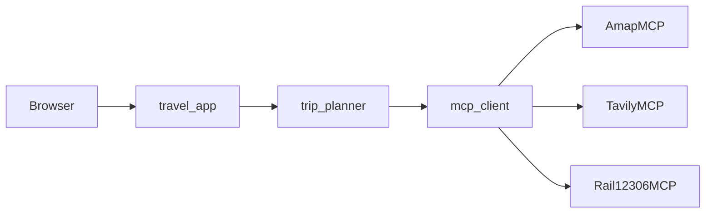

# 把一句口语收成能发给同伴的路书：Roadbook 的技术与实现

> 开源仓库：[https://github.com/OWNER/REPO](https://github.com/OWNER/REPO)  
> 本文可直接贴到 CSDN 与微信公众号。公众号若不便渲染流程图，可删掉文中「架构图（Mermaid）」一小节，正文已用文字讲清同一条链路。

---

## 上篇 · 技术：为什么这样设计

### 1. 要解决的问题

出行前真正缺的，往往不是又一篇攻略，而是**同车人能一起认的一版路**：去哪、怎么走、每天保什么、晚点砍什么、钱大概落不落在自己设的区间里。做成的标志不是下单，而是三件事同时成立：

1. 封面用四句话读完这趟；
2. 每一天标题下有一句取舍；
3. 发给同伴时，链接指向真实的只读分享页——写不成链接，就不拿假二维码充数。

因此产品边界很清楚：短信登录后生成与改路；高铁卡只展示参考班次并跳到 12306；不做订票、订房、攻略广场，也不做多人同时改同一份路书。

### 2. 主路径：规则规划，而不是让模型重写正文

路书里的日程、预算、避坑，用户会拿着去核对「人均还在不在档」「改完多开了多少公里」。这些数字和取舍必须**可解释、可重算**。若主路径依赖大模型每次重写全文，同一句需求两次结果可能差很远，副驾驶改完也很难说清后果。

Roadbook 的选择是：

- **默认**用规则与工具结果拼出路书：途经落点、逐日站点、油电过路费估算、行前清单、适合谁 / 慎选。
- **大模型**不挡在主路径上。只有环境打开精修开关、且在时限内返回时，才替换部分文案；界面没有单独的「精修」开关。
- **对话改路**同样以规则识别意图为主（改天数、途经、节奏、主题、预算等）；改起终点或途经城时可能触发高德重新算路——产品话术里不会写「绝对零增本」。

这样，用户看到的「最长一天大约多少公里」「人均是否在档」，都能回溯到同一套公式与路线数据，而不是一次生成的散文。

### 3. MCP 放在哪一层

外部能力（高德路线与天气、Tavily 配图、12306 班次）统一经 MCP 子进程调用，而不是把各家 SDK 散落在业务函数里。好处有三：

- 规划器只关心「工具名 + 参数 → 文本 / 结构化结果」；
- 缺少 API Key 时跳过对应服务并打警告，**进程仍能起来**，便于本地先跑通页面；
- 桌面示例 MCP（数一下桌面有几个 txt）与出行 MCP 共用同一套客户端，方便演示「Agent + 多 MCP」而不绑架主产品。

MCP 提供的是**事实材料**（折线、天气、POI、班次参考）。把材料收成「封面四句、每天保什么砍什么」的，仍是规划与前端的产品逻辑。

### 4. 边算边画：SSE 而不是一次转圈

完整规划要落坐标、画路线、查天气、排日程，若等全部算完再返回，手机上只会长时间转圈。接口 `/api/plan` 用 **SSE** 分段推送：先出标题与骨架（里程显示「计算中」），再补路线、天气与逐日内容。前端按 stage 增量渲染，状态文案依次写「理解需求 → 落坐标 → 画出路线 → 查天气 → 整理行程」。

改路走另一条接口（对话微调、途经重排），在**新路书上整本重算**，不另开一套方案列表；回复末尾接一句后果：全程少开或多开大约多少公里，以及人均仍在 / 低于 / 超出区间。

### 5. 分享：只读快照与「真链接才画码」

「发出这一版」写入一份公开快照，同伴打开分享页免登录可看、可导航，但不能改原件。已登录用户可以收藏到本机，或「据此修改」复制成自己的草稿。

海报绘制时会请求写入公开链接：**写成了才画二维码**；失败则不画假码，复制按钮停在「链接未就绪」。下载 PNG 随时可用，但文案会写明链接暂未写成——避免同伴扫到空码却以为能打开行程。

### 6. 架构图（Mermaid）

> 公众号编辑器若不支持 Mermaid，删除本小节即可；上一节文字已覆盖同一结构。



---

## 下篇 · 实现：代码怎么对上上面的设计

仓库地址：[https://github.com/OWNER/REPO](https://github.com/OWNER/REPO)。下列路径均相对仓库根目录。

### 1. 一次生成怎么走完

后端入口在 `travel_app.py`：`POST /api/plan` 读请求体，调用 `trip_planner.plan_trip_async`，把 stage 回调写成 SSE。前端 `static/js/roadbook-ui.js` 里的 `startPlan` 消费这些事件并交给 `handleStage`。

规划主链路（`trip_planner.py`）可以记成：

1. `parse_trip_request`：从表单与口语里抽出出发地、目的地、天数与偏好（节奏、主题、预算档、自驾 / 高铁+租车等）；句子说不清时，前端会先走「说清需求」半屏（`static/js/brief-chat.js`），写回后再生成。
2. `plan_trip_async`：编排整次规划，并通过 `stage` 推送骨架与中间结果。
3. `_gather_amap_staged`：经 MCP 向高德取路线、天气等，边取边推。
4. `_build_fast_itinerary`：用规则直接交出可看的逐日路书（主路径，不默认等大模型）。
5. 出行方式为高铁+租车时，`_maybe_attach_hsr`（及 `rail_hsr.py`）附上班次参考与到站租车天数，并外链购票。

预算、清单、适合谁 / 慎选分别由 `_build_budget`、`_build_checklist`、`_build_fit_verdict` 生成，再交给界面。

### 2. 封面四句、每天一句、改完的后果句

这些文案是产品「敢不敢出发、改完能不能看清后果」的关键，对应实现是：

| 用户看到的 | 主要位置 |
|------------|----------|
| 封面四句（去哪 / 最长一天 / 人均是否在档 / 必知） | 前端 `renderFirstGlance`（`roadbook-ui.js`） |
| 每天一句取舍（出发窗 · 今天保 · 晚点先砍） | 前端 `dayPlayLine` |
| 改路后的里程差与人均是否在区间 | 后端 `_edit_consequence_line`；对话入口 `apply_chat_edit_async`，途经拖拽 `apply_via_reorder_async` |

对话与拖拽都在新 trip 上重算；前端用 `mutationEpoch` 丢弃过期的 SSE / 改路响应，避免连点导致旧结果盖住新结果。

### 3. 前端怎么分层

| 文件 | 职责 |
|------|------|
| `static/js/roadbook-ui.js` | DOM、事件、SSE、地图、海报、本地草稿与历史 |
| `static/js/roadbook-core.js` | 预算重算、换一换等无 DOM 逻辑（便于以后搬小程序） |
| `static/js/platform-bridge.js` | 导航、剪贴板、存储、密度 |
| `static/js/brief-chat.js` | 需求不完整时的追问与写回 |
| `static/js/weather-fx.js` | Canvas 天气粒子 |
| `static/css/roadbook.css` | 信息架构与深浅色 token |

状态键包括 `roadbook_v1_history`、`roadbook_v1_edits`（含 trip 快照与清单勾选）；刷新页可恢复上次草稿。有路书后，底部悬浮胶囊才是副驾驶入口：左侧展开对话，右侧「收藏」与「海报」。

### 4. 登录与写操作保护（职责说明）

- `auth_pnvs.py`：图形验证码、短信发码配额、校验与会话 Cookie。
- `travel_app.py` 里的 `RequireLoginMiddleware`：未登录访问规划页与受保护 API 时重定向或返回 401；分享页 `/s/...` 等公开路径放行。
- 写操作通过 CSRF：前端 `static/js/csrf.js` 为非 GET 的 `fetch` 带上令牌，中间件比对 Cookie 与请求头。

生产环境还需短信服务商配置与反向代理限流；**本开源仓库不包含指向具体机器的部署脚本与口令文件**，避免把运维细节和密钥习惯带进公开历史。本地请用 `.env.example` 自行配置。

### 5. MCP 客户端怎么挂

`mcp_client.py` 的 `_build_servers()` 按环境变量注册：

- 有 `AMAP_MAPS_API_KEY` → 高德 `@amap/amap-maps-mcp-server`
- 有 `TAVILY_API_KEY` → `tavily-mcp`
- `12306-mcp` 无 Key 依赖，始终可注册
- 本地 `desktop_txt_mcp.py` 作为演示用 MCP

`travel_app` 启动时会 `warmup_servers`，规划阶段通过 `call_server_tool` / 持久会话复用子进程，减少每次 stdio 冷启动。

### 6. 本地怎么跑起来

```bash
git clone https://github.com/OWNER/REPO.git
cd REPO
python3 -m venv .venv && source .venv/bin/activate
pip install -r requirements.txt
cp .env.example .env   # 填入你的 Key
python travel_app.py   # http://127.0.0.1:7861
```

更细的产品主路径见仓库内 `docs/product-design.md`；API 与交互真值表见 `docs/roadbook-spec.md`；组件与视觉语言见 `docs/interaction-ui.md`。

---

## 结语

Roadbook 想证明的是一件小事：在出行场景里，**把「可发给同伴的一版」设计清楚**，往往比堆更多生成能力更重要。规则规划保证数字和取舍说得清；MCP 把地图与班次等外部事实接进来；SSE 让等待变成可感知的进度；分享坚持真链接才画码。欢迎在 GitHub 上 star、提 issue，或直接改一版适合自己团队的路书页。

仓库：[https://github.com/OWNER/REPO](https://github.com/OWNER/REPO)
